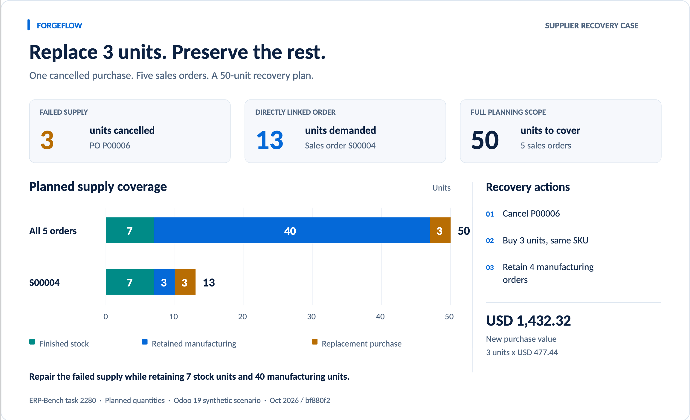
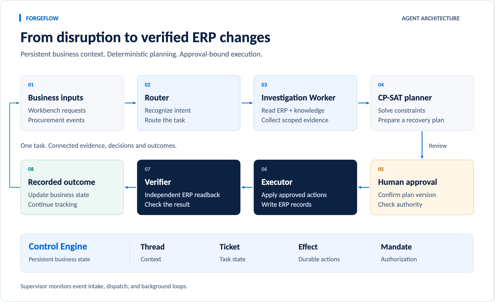

# ForgeFlow

**Manufacturing recovery, from disruption to verified ERP changes.**

ForgeFlow is an AI-agent workbench for recovering purchase and production plans
after supplier cancellations and manufacturing disruptions. It connects
business investigation, constraint-based planning, human approval, and ERP
execution in one traceable workflow.

[Open the workbench](https://forgeflowagent.com/app/) ·
[Benchmark results](#benchmark-results) ·
[One recovery case](#one-recovery-case) ·
[Architecture](#architecture) ·
[Source setup](#source-setup)

The hosted workbench uses project-provided access credentials.

Current Odoo 20 code includes multi-product procurement and multi-level BOM /
multiple-MO recovery. Recorded acceptance uses isolated synthetic environments.
Implementation, versioned evidence and permitted use remain distinct; customer
production ERP writes remain blocked pending verified acceptance.

```text
Investigate → Prepare a plan → Review and approve → Execute → Read back and verify
```

## What ForgeFlow delivers

| Capability | Business outcome |
| --- | --- |
| **Evidence-backed investigation** | Connect the disruption to affected orders, existing supply, inventory, and relevant business rules. |
| **Constraint-based recovery planning** | Use OR-Tools CP-SAT to calculate purchase and manufacturing plans under the selected scenario's quantity, timing, resource, and economic constraints. |
| **Approval-bound execution** | Bind a specific plan to an authorized decision, then apply its recorded business actions. |
| **Independent ERP verification** | Read the resulting records back from the ERP and keep the plan, execution journal, and verification result connected. |

## Benchmark results

**100/100 on both selected ERP-Bench recovery tasks.**

| Recovery task | Original verifier score | Applicable rules passed |
| --- | ---: | ---: |
| Supplier cancellation — task `2280` | **100 / 100** | **51 / 51** |
| Workcenter outage — task `2299` | **100 / 100** | **95 / 95** |

*Recorded product-approval workflow acceptance · Odoo 19 synthetic scenarios ·
October 2026 · evaluated source `bf880f2` · original ERP-Bench verifier.*

[Supplier-cancellation report][a-report] ·
[Supplier-cancellation raw score][a-score] ·
[Workcenter-outage report][b-report] ·
[Workcenter-outage raw score][b-score]

These benchmark records are preserved at a fixed public commit. The current
source tree includes the Odoo 20 integration; the table identifies the environment
used for these recorded results.

## One recovery case

A supplier withdraws a **3-unit purchase** linked to a **13-unit sales order**.
The recovery plan coordinates **five sales orders totaling 50 units**.

ForgeFlow replaces the failed purchase while retaining the valid supply
arrangements:



**Planned supply:** 7 units from finished stock + 40 from retained manufacturing +
3 from replacement purchasing = **50 units**.

For the directly linked order, the plan covers all **13 units** from the combined
finished stock, retained manufacturing, and replacement supply.

The approved recovery produces **two purchase-document actions** and **seven
verified execution steps**, followed by the **51/51** original-verifier result.

[Recorded case and plan][case-record] · [Execution receipt][a-execution]

## Architecture

ForgeFlow separates model-driven investigation, numerical planning, and
business execution. The control layer persists task progress and validates the
authority to move from one stage to the next.



The workbench assistant explains scoped business evidence through read-only
tools. The investigation runtime can produce structured plan requests. CP-SAT
solves the numerical constraints, and the controlled execution path applies the
approved actions.

Source entry points:
[Router and workers](src/forgeflow/superagent/workers.py) ·
[Plan preparation, execution, and verification](src/forgeflow/superagent/plan_effects.py) ·
[API and workbench operations](src/forgeflow/api/app.py)

## Knowledge and business facts

Document knowledge and ERP records serve complementary purposes. Documents
supply policy and product context; structured ERP queries establish the
identifiers, quantities, dates, and states needed for a recovery decision.

The source includes document-processing and semantic-retrieval modules. The
semantic answer adapter applies server-resolved tenant, document-generation,
and access-control scope before retrieval, and supports configured embedding
and reranking services.

[Scoped semantic answers](src/forgeflow/knowledge/semantic_answer.py)

## Repository layout

| Path | Contents |
| --- | --- |
| `src/forgeflow/` | Python application, FastAPI backend, assistant runtime, planning, and ERP integration |
| `src/forgeflow/superagent/` | Routing, investigation, persistent control, and recovery effects |
| `src/forgeflow/planning/` | Constraint models and action preparation |
| `src/forgeflow/integrations/odoo20/` | Odoo 20 business integration |
| `src/forgeflow/knowledge/` | Document and knowledge services |
| `web/` | React and TypeScript workbench |
| `odoo-addons/` | ForgeFlow Odoo add-on code |
| `migrations/` | PostgreSQL control-layer migrations |
| `contracts/` | Task-policy contracts |
| `tests/` | Source-level and integration tests |

## Source setup

### Requirements

- Python **3.12–3.14** and `uv`
- Node.js **20.19+ or 22.12+**, with npm

### Install dependencies and build the frontend

```bash
git clone https://github.com/KevinXia69/ForgeFlow.git
cd ForgeFlow

cp .env.example .env
uv sync --frozen --extra planning

(
  cd web
  npm ci
  npm run typecheck
  npm run build
)
```

The frontend build is written to `web/dist` and is served under `/app/` by the
API. These steps prepare the source checkout and frontend assets.

### Runtime configuration

The application provides the following API entry point for a configured
environment:

```bash
uv run forgeflow api --host 127.0.0.1 --port 8000
```

Set the API configuration in the process environment before starting it:

| Setting | Purpose |
| --- | --- |
| `FORGEFLOW_SESSION_SECRET` | Session signing secret, at least 32 characters |
| `FORGEFLOW_INVITE_CODES` | Comma-separated invitation codes, each at least 16 characters |
| `FORGEFLOW_DEPLOYMENT` | Deployment mode; use `local` for local development |
| `FORGEFLOW_SECURE_COOKIE` | Use `false` only for plain-HTTP loopback development; keep `true` for HTTPS |

For the persistent Odoo 20 workflow, configure a PostgreSQL control database,
an Odoo 20 instance with the ForgeFlow add-on, and the required service processes.
Model, semantic-search, and document-parsing services are configured for the
features being used. Merely copying `.env.example` does not initialize these
services or load their data.

The current `.env.example` contains model-profile examples; choose the profile
for the environment you are configuring.

[API settings](src/forgeflow/api/settings.py) ·
[CLI entry points](src/forgeflow/cli.py) ·
[Python dependencies and optional features](pyproject.toml)

## Tests

Run from the repository root:

```bash
uv run --extra planning pytest tests -q

(
  cd web
  npm run typecheck
  npm run build
)
```

The suite includes external-service and upstream-fixture integrations. Configure
the relevant services for those checks and retain the passed, failed, and skipped
counts in the test report. Target-environment and customer acceptance remain
separate requirements; publishing a source revision does not approve customer
production writes.

## Public source and upstream projects

This repository contains the application source, Odoo add-on, migrations,
contracts, web client, and tests. Runtime data, upstream benchmark fixtures,
reference solutions, model weights, and deployment credentials are supplied
separately. The recorded benchmark links above resolve to the public history.

ForgeFlow builds on ERP-Bench, Pi, DeepSeek Harness, Odoo, PostgreSQL, Harbor,
and Google OR-Tools. Upstream attribution and version details are maintained in
[NOTICE](NOTICE) and [THIRD_PARTY_NOTICES.md](THIRD_PARTY_NOTICES.md).

## Security

Keep credentials and customer records out of the repository. Use dedicated test
ERP instances and synthetic data for experiments. Human approval and server-side
authorization govern business execution. Report security issues privately to
the repository owner.

## License

ForgeFlow is licensed under [Apache License 2.0](LICENSE).
Third-party materials retain the licenses recorded in [NOTICE](NOTICE).

[a-report]: https://github.com/KevinXia69/ForgeFlow/blob/9c673c8d479b238a18c489fab0dbac057fb72977/docs/evidence/2026-10-28-next-phase/A-final/report.json
[a-score]: https://github.com/KevinXia69/ForgeFlow/blob/9c673c8d479b238a18c489fab0dbac057fb72977/docs/evidence/2026-10-28-next-phase/A-final/original-reward.raw.json
[b-report]: https://github.com/KevinXia69/ForgeFlow/blob/9c673c8d479b238a18c489fab0dbac057fb72977/docs/evidence/2026-10-28-next-phase/B-final/report.json
[b-score]: https://github.com/KevinXia69/ForgeFlow/blob/9c673c8d479b238a18c489fab0dbac057fb72977/docs/evidence/2026-10-28-next-phase/B-final/original-reward.raw.json
[case-record]: https://github.com/KevinXia69/ForgeFlow/blob/9c673c8d479b238a18c489fab0dbac057fb72977/README.md#one-case-from-disruption-to-verified-result
[a-execution]: https://github.com/KevinXia69/ForgeFlow/blob/9c673c8d479b238a18c489fab0dbac057fb72977/docs/evidence/2026-10-28-next-phase/A-final/executed.json
