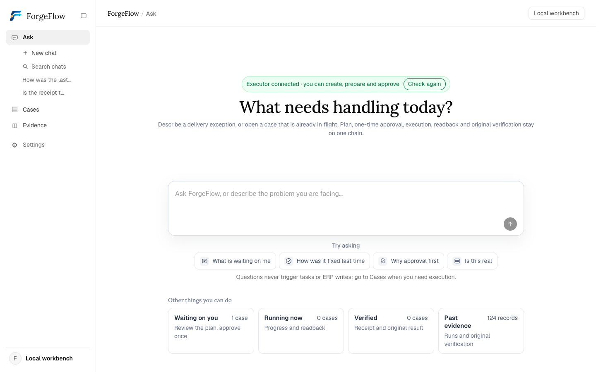
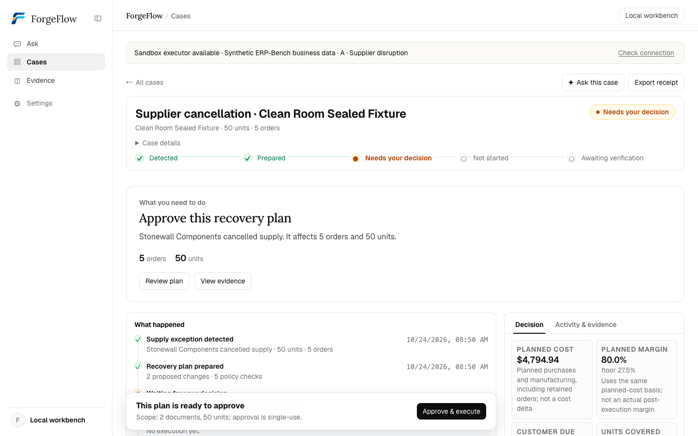

# ForgeFlow

**Manufacturing delivery exceptions: detect → plan → one approval → apply → read back from ERP → original acceptance.**

You approve a plan once, and that exact plan is what gets applied. Afterwards the
ERP is read back and compared with the plan, and the result comes from the
acceptance program that ships with the task.



<p>
  <a href="https://github.com/KevinXia69/ForgeFlow/blob/main/LICENSE"></a>
  <a href="https://www.python.org/"></a>
  
</p>

Research runs on **Nebius Token Factory** with **NVIDIA Nemotron 3.5 Super VL**,
model id `nvidia/Nemotron-3.5-Super-VL`. Setup lives in
[model settings](./docs/en/model-settings.md). Product planning is a CP-SAT
constraint solve that runs offline.

[How it differs](#how-it-differs) · [One case, end to end](#one-case-end-to-end) ·
[Status](#status) · [Product docs](./docs/en/README.md)

---

## What it is

A supplier cancels, a line goes down, a deadline collapses. Someone digs through
the ERP and edits a pile of documents from experience, and a week later nobody
can say why it was done that way or what actually changed.

The cost arrives later. A late delivery, a penalty, a customer who doesn't
reorder, a change nobody can defend.

| Before ForgeFlow | With ForgeFlow |
| --- | --- |
| The cancellation is noticed when the line is already idle | The exception becomes a case, with the orders, quantities and dates attached |
| The fix lives in one person's head and a pile of ERP edits | The plan is written down, checked against policy, and approved once |
| "Done" means somebody said so | The ERP is read back, and the task's own acceptance program scores it |

ForgeFlow is built for that hour. It does one thing:

1. It starts from the exception, so a case knows which orders are affected,
   which product, how many units, and when they are due.
2. It checks the plan against each policy separately: the margin floor, each
   order's budget, demand coverage, on-time delivery, and the original contract.
   You see which rule failed instead of a single score.
3. You approve once. The approval records the plan version you saw and the state
   of the ERP at that moment, and it expires.
4. Only then does it write: the disrupted purchase order is cancelled, new
   purchase and manufacturing orders are created, and workcenters are scheduled.
5. It reads the ERP back and compares the result with the plan.
6. The task's own acceptance program counts the rules it checks and gives the
   score.



## One case, end to end

A supplier cancels a confirmed purchase order: **5 orders, 50 units, due in 8
days**.

The workbench reads the ERP and solves inside the task's policy contract, which
sets the budget, the margin floor and the supplier limits. The plan it produces
costs **$4,794.94**, holds **80% margin against a 27.5% floor**, and changes 2
documents.

Nothing is written yet. When you approve, that approval binds this plan version.

Then it writes the 2 documents, reads them back, and the task's acceptance
program scores **51 out of 51 rules, 100.00 out of 100**.

Three questions to try:

| Ask | What you should get back |
| --- | --- |
| What is waiting on me? | The one case that needs a decision, and the reason it can't be approved yet |
| How was the last cancellation fixed? | What was written, what came back on readback, what the acceptance program said |
| Is the receipt real? | Where it comes from, and how far it goes |

## Boundaries

Chat answers questions; writes start only after your approval, and the approval
expires. The product covers two kinds of disruption, supplier cancellations and
workcenter outages, on one task family. When the outcome of a write is unknown,
the case says so and waits for a person.

## How it differs

| The usual approach | What ForgeFlow does |
| --- | --- |
| A chat assistant suggests a fix | The plan is a document you approve, and that plan is what gets applied |
| An agent edits the ERP directly | Every write goes through one executor process, and it can only touch the documents the plan lists. An unknown outcome is reported and not retried |
| A planner scores its own output | The acceptance program that ships with the task sets the score |

## Running it in five minutes

You need Python 3.12+, [uv](https://docs.astral.sh/uv/) and Docker (Colima is
fine). You have to build the UI and pull an image for the sandbox, so this is
longer than a `pip install`.

```bash
# 1. Fetch the pinned upstream sources and install (first run needs network, ~2 min)
python3 scripts/fetch_upstream.py
uv sync --frozen

# 2. Self-check: config, toolchain, Docker. No model calls.
uv run forgeflow doctor

# 3. Build the workbench front end
cd web && npm ci && npm run build && cd ..

# 4. Start the local workbench (initialises the sandbox on first run)
uv run python scripts/local_workbench.py init
uv run python scripts/local_workbench.py start   # -> http://127.0.0.1:8000
```

Sign in with the fixed local invite code `demo-invite-code-0001` (see
[`scripts/local_workbench.py`](./scripts/local_workbench.py)). The session key is
generated separately and kept out of the repository.

If you only want the tests, skip Docker:

```bash
uv run pytest -q
```

These steps and the test command were run on a clean clone of this repository.
The tests that need recorded runs under `runs/` skip themselves, because `runs/`
stays out of the repository.

## Why you can check it

Every claim below points at something you can run.

| What you want to know | Where to look |
| --- | --- |
| How each interface claim is verified | [`web/e2e/`](./web/e2e/) holds six acceptance harnesses, plus contrast and accessibility checks |
| Whether the two front ends tell one story | `uv run python scripts/check_web_parity.py` compares them |
| Whether the product still works end to end | `bash scripts/first_look_audit.sh` starts its own read-only API and runs 11 checks |
| What a finished run looks like | the Evidence screen in the running product, or [`docs/CAPABILITY_MATRIX_EN.md`](./docs/CAPABILITY_MATRIX_EN.md) |
| What is simulated and what is real | [`docs/EVIDENCE.md`](./docs/EVIDENCE.md) explains the split |

## Status

It runs end to end, from the exception through one approval to execution,
readback and acceptance. The workbench, the review bundle and the offline suite
all pass from a clean clone.

The hosted Scenario A workflow, isolated Odoo/PostgreSQL recovery, and normal OS
reboot are now recorded in the [October 25 VPS acceptance evidence](./docs/evidence/2026-10-25-vps/README.md).
Whole-site recovery onto another VPS, a new approval after reboot, and a
screen-reader audit remain untested. Research is a separate track, and it has
failed three runs in a row. Those results stay in the repository.

## Repository layout

```
src/forgeflow/        Product: cases, plans, approval, execution, readback, acceptance, Q&A
  api/                FastAPI: read-only paths and the approval path
  recovery/           Change set, compiler, readback, scope guard
  planning/           Offline solving (cp-sat); no model calls
web/                  Private workbench (bilingual, React + Vite)
web-public/           English review front end (read-only, same story)
contracts/            Task policy contracts (budgets, margin, forbidden vendors/workcenters)
tests/                Test suite plus synthetic fixtures
docs/                 Product reference material (English), plus the deck and demo
docs/images/          Screenshots used by this file
scripts/              Upstream fetch, local workbench, first-look audit, parity checks
```

## Development and gates

```bash
uv run pytest -q                                      # full test suite
uv run python scripts/check_typography.py             # 14px minimum type size
uv run python scripts/check_web_parity.py             # the two front ends stay in step
cd web && npm run typecheck && npm run test:hermetic  # types + hermetic end-to-end
bash scripts/first_look_audit.sh                      # the whole audit in one command
```

CLI entry points:

```bash
uv run forgeflow doctor      # read-only self-check
uv run forgeflow api         # product API and UI
uv run forgeflow tasks       # list the current tasks
uv run forgeflow run --help  # run a task from an isolated start state and keep the original score
```

## Upstream and license

- Reuses [ERP-Bench](https://github.com/agentic-labs/erp-bench) Odoo tasks, the Pi
  single-agent tool loop that the research runs use, and the original acceptance
  program. Versions are pinned in [`upstream.lock.json`](./upstream.lock.json) and
  verified by commit hash, so this repository does not nest another one.
- Third-party sources and local changes: [`THIRD_PARTY_NOTICES.md`](./THIRD_PARTY_NOTICES.md).
- Code in this repository is [Apache-2.0](./LICENSE).
