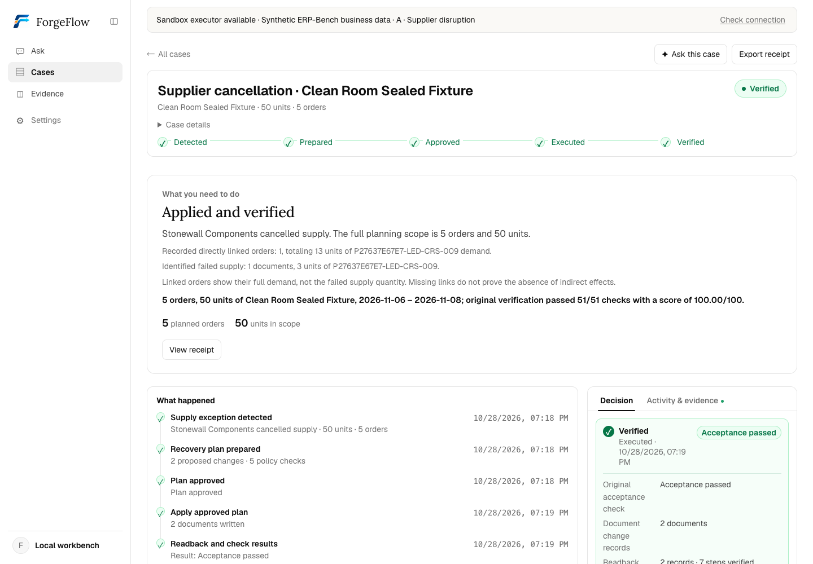

# ForgeFlow

**Repair manufacturing plans after supplier cancellations and workcenter outages.**

ForgeFlow is a workbench for reviewing, approving and applying changes to
existing purchase and manufacturing plans. It reads the ERP back after execution
and presents the original task verifier's result.

Built on two [ERP-Bench](https://github.com/agentic-labs/erp-bench) recovery tasks,
it reuses their synthetic business data, Odoo environments, planning reference
solver and acceptance programs. **NVIDIA Nemotron on Nebius Token Factory**
answers questions from case evidence; **CP-SAT** handles product planning.

[Try the demo](#try-the-demo) · [Follow one case](#one-case-from-disruption-to-verified-result) ·
[Scope and evidence](#scope-and-evidence) · [Run locally](#run-the-product-locally) ·
[Product docs](./docs/en/README.md)



*Actual local Scenario A after approved execution, using synthetic data and
source `bf880f2`. [Screenshot provenance](./docs/media/next-phase/README.md).
Hosted deployment evidence is listed separately below.*

## The problem: repairing an existing plan

Orders are already confirmed. Stock, purchases and manufacturing commitments
are already in place. Then a supply path becomes unavailable:

- **Supplier cancellation:** Stonewall Components withdraws a confirmed purchase.
  Find another fulfillment route for Alpine Theater while retaining valid
  commitments. [Original Scenario A](https://github.com/agentic-labs/erp-bench/blob/ceba3880af555129b5278e056a0c20f2fb5a0ba9/tasks/2280_medium_repair_plan_medium/instruction.md).
- **Workcenter outage:** Assembly Line 1 goes down with manufacturing orders
  scheduled on it. Cancel the affected manufacturing orders and find feasible
  alternatives. [Original Scenario B](https://github.com/agentic-labs/erp-bench/blob/ceba3880af555129b5278e056a0c20f2fb5a0ba9/tasks/2299_hard_repair_plan_hard/instruction.md).

The tasks allow buying finished goods, manufacturing or a mix. Delivery dates,
customer budgets, margin floors, supplier limits and workcenter capacity remain
binding. Preserving valid work and linking sales orders to their supplies are
original task requirements. The stated priority is to preserve prior work,
then minimize purchasing and manufacturing spend among equally preserving plans.

## What ForgeFlow adds

ERP-Bench supplies the business problem, environment, reference planner and
original verifier. ForgeFlow turns those foundations into a reviewable product
workflow:

| Decision or question | What the workbench provides |
| --- | --- |
| What does the disruption affect? | A case with total demand, directly linked orders, failed supply and the existing supply relationships |
| Which plan should we use? | Concrete document changes, constraint checks and candidate objectives with their tradeoffs |
| What am I authorizing? | An expiring approval bound to the selected plan and captured ERP state |
| What actually happened? | Controlled execution, a persistent journal, ERP readback and a case-bound original-verifier receipt |

**Case → plan and checks → explicit approval → execution → ERP readback → original acceptance.**

The default objective minimizes quantity deviations on existing supply paths,
then planned cost. Alternatives prioritize planned cost or manufacturing minutes;
equivalent candidates are deduplicated. The assistant explains the
case through scoped tools and does not approve or execute writes.

## One case, from disruption to verified result

**1. Existing commitments.** Scenario A contains **5 orders and 50 units**, due
in **8–10 days**, with 7 finished units in stock. Alpine Theater's order is
13 units, due in 10 days.

**2. Disruption.** Stonewall Components' failed finished-goods purchase covers
**3 units** linked to Alpine Theater. The full 50-unit planning scope, the
13-unit linked order and the 3-unit supply gap describe different things.

**3. Proposed repair.** The recorded default plan replaces that purchase while
retaining the other planned purchasing and manufacturing commitments:

| Part of the plan | Existing arrangement | Repaired arrangement |
| --- | --- | --- |
| Failed supply | 3 units from Stonewall Components | Cancel that purchase order |
| Replacement supply | No replacement purchase | Create a 3-unit purchase from an alternative supplier |
| Finished stock | 7 units available | Use 7 units toward the orders |
| Other valid commitments | 5 component purchases and 4 manufacturing orders for 40 finished units | Retain their planned quantities |

**Planned purchasing and manufacturing cost is $4,794.94**, including retained
commitments. This is the whole plan's cost, not the cost increase caused by the
cancellation. The **new-spend margin is 76.75% against a 27.5% floor**: the
43 purchased/manufactured finished units cover $20,623.23 of sales revenue;
finished-stock revenue is excluded. See the [proposed plan and changes](./docs/evidence/2026-10-28-next-phase/A-final/selected.json)
and [metric definitions](./docs/en/current-capabilities.md#new-spend-margin).

**4. Approval and execution.** Review the proposed changes and checks, then
approve that exact plan. In this recorded acceptance, an authorized HTTP driver
issued the approval before the UI capture. The receipt records **two purchase-document
actions and seven verified execution steps**; neither is a database-write count.

**5. Verified result.** ERP readback and the original verifier confirmed
**51/51 applicable rules and 100/100** for this local sandbox run on `bf880f2`.
[Acceptance report](./docs/evidence/2026-10-28-next-phase/A-final/report.json) ·
[Execution receipt](./docs/evidence/2026-10-28-next-phase/A-final/executed.json) ·
[Original reward](./docs/evidence/2026-10-28-next-phase/A-final/original-reward.raw.json).

## Try the demo

Open [the hosted workbench](https://forgeflowagent.com/app/) with the private judge
invite supplied with the submission. Follow the [judge guide](./docs/en/judge-guide.md)
to prepare Scenario A, inspect the plan, ask about its changes, approve it and
review the receipt. Judges need no model account or local installation.

Each invite selects a separate persistent workspace. Approval writes to that
workspace's synthetic Odoo sandbox; cases and ERP records survive sign-out and
restart. Execution does not reset the sandbox. Access, capacity and operator
recovery details are in the [VPS guide](./deploy/vps/README.md).

The hosted service was upgraded to source `a02a197` on October 29. An isolated
QA workspace passed real HTTPS approval and original acceptance; production
restart and replay preserved its receipt. See the [upgrade record and access-check limits](./docs/evidence/2026-10-29-public-upgrade/README.md).
The domain uses automatic HTTPS renewal; the original IP remains available.
The [domain migration checks](./docs/evidence/2026-10-29-domain/README.md) cover both
entry points, invitation isolation and preservation of existing state.

## Scope and evidence

| Track | Recorded scope and result | Evidence |
| --- | --- | --- |
| Current local A, source `bf880f2` | Supplier cancellation; approved execution, readback, 51/51 rules, 100/100 | [A-final](./docs/evidence/2026-10-28-next-phase/A-final/report.json) |
| Current local B, source `bf880f2` | Workcenter outage; approved execution, readback, 95/95 rules, 100/100 | [B-final](./docs/evidence/2026-10-28-next-phase/B-final/report.json) |
| Current hosted A, source `a02a197` | Isolated QA through public HTTPS: 51/51 rules, 100/100; production restart/replay preserved the receipt; five judge environments retained | [October 29 upgrade](./docs/evidence/2026-10-29-public-upgrade/README.md) |
| Historical hosted A | Earlier deployment; real sandbox writes, model calls and separately scoped recovery/concurrency checks | [VPS record](./docs/evidence/2026-10-25-vps/README.md), [reviewer record](./docs/evidence/2026-10-26-reviewers/README.md) |
| Autonomous research | Separate model-driven trials, with retained passes, failures, timeouts and configuration limits | [Recorded results](./docs/en/evaluation.md), [limits](./docs/en/limits.md) |

The current A/B runs use authorized HTTP approval drivers. The original tasks
request autonomous execution; passing their business verifier through the
product workflow is not evidence of autonomous model completion.

Complete product execution supports **one finished product and a single-level
BoM**. The `planning-metadata-v1` profile makes existing manufacturing time,
cost and lead time visible in workcenter notes. Default preservation does not
guarantee globally minimal ERP writes. The optional retention refinement is
**off by default**. See [current capabilities](./docs/en/current-capabilities.md)
for candidate tradeoffs, data visibility and recovery boundaries.

Tests provide different kinds of evidence. The [release validation record](./docs/evidence/2026-10-28-next-phase/README.md)
reports 3062 backend tests passed and 40 skipped, plus frontend checks with their
source versions. `first_look_audit.sh` checks the UI against a read-only API; it
does not start an ERP or prove approved execution. The [evidence index](./docs/EVIDENCE.md)
separates those checks from real sandbox acceptance. Historical receipts and
media retain their original dates and metric definitions.

## Run the product locally

Use Ubuntu 24.04 or Ubuntu under WSL2, with Python 3.12, [uv](https://docs.astral.sh/uv/),
Node.js 24/npm and Docker. Allow at least 4 CPUs, 8 GiB RAM and 20 GiB disk.
Native Windows PowerShell is unsupported. Initial dependencies and image builds
need network access and may take substantially longer than five minutes.

The commands below start the default planning path. To compare objective
priorities, choose the [optional candidate setup](./docs/LOCAL_WORKBENCH.md#optional-candidate-comparison)
before the first `init`. Run from a fresh checkout in a Linux shell:

```bash
python3 scripts/fetch_upstream.py
uv sync --frozen --extra planning --extra dsh-sdk
uv run forgeflow doctor
(cd web && npm ci && npm run build)
uv run python scripts/build_local_image.py --scenario A
uv run python scripts/local_workbench.py init
uv run python scripts/local_workbench.py start
```

Open `http://127.0.0.1:8000/app/` with the local development invite
`demo-invite-code-0001`. Planning, approval and execution can run without a model
key. For AI answers, configure the [optional assistant](./docs/LOCAL_WORKBENCH.md#optional-ai-assistant)
before starting. The [local guide](./docs/LOCAL_WORKBENCH.md) covers Scenario B,
stop/resume and troubleshooting; the launcher is for local development.

## Architecture and development

- **Assistant:** NVIDIA Nemotron 3.5 Super VL (`nvidia/Nemotron-3.5-Super-VL`)
  via Nebius Token Factory, using scoped case/evidence tools through DSH.
  [Model settings](./docs/en/model-settings.md).
- **Planner:** the pinned ERP-Bench CP-SAT reference solver, integrated with
  live snapshots, candidate objectives and independently checked change sets.
- **Executor:** ForgeFlow owns approval validation, scoped ERP operations,
  journaling and readback. Uncertain execution follows controlled recovery.
- **Verifier:** the original ERP-Bench acceptance programs supply the task result.

See [architecture](./docs/en/architecture.md) and [release/recovery instructions](./docs/NEXT_PHASE_RELEASE.md).

```text
src/forgeflow/   API, cases, planning, approval, recovery, verification and Q&A
web/            Bilingual React workbench
web-public/     English workbench with deployment-controlled write capabilities
contracts/      Versioned task policies
tests/          Automated checks and synthetic fixtures
docs/           Guides, dated evidence and screenshots
scripts/        Setup, local lifecycle and validation tools
```

```bash
uv run pytest -q                                     # backend suite; some fixtures/platforms skip
uv run python scripts/check_typography.py            # typography checks
uv run python scripts/check_web_parity.py            # frontend consistency
(cd web && npm run typecheck && npm run test:hermetic) # mock-API interface checks
bash scripts/first_look_audit.sh                     # read-only UI/API audit
```

The backend suite does not require Docker. Live ERP acceptance and model calls
have separate records and setup requirements.

## Upstream and license

- **ERP-Bench:** task statements, synthetic data, Odoo environments, procurement/
  planning reference solvers and original acceptance programs. Pinned at
  [`ceba3880af555129b5278e056a0c20f2fb5a0ba9`](https://github.com/agentic-labs/erp-bench/tree/ceba3880af555129b5278e056a0c20f2fb5a0ba9).
- **Pi:** the single-agent tool loop used by autonomous research. Source versions
  and hashes are recorded in [`upstream.lock.json`](./upstream.lock.json).
- ForgeFlow code is [Apache-2.0](./LICENSE). Third-party code and services retain
  their own terms; see [sources and licenses](./THIRD_PARTY_NOTICES.md).
