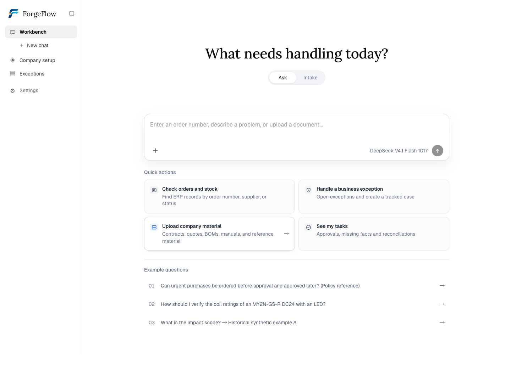

# ForgeFlow

**从采购或生产异常，到经过核验的 ERP 变更。**

ForgeFlow 将 AI 问答、资料检索、约束规划、人工审批和执行回读连接到同一个工作台。
你可以调查供应商取消或生产中断，审阅具体恢复方案，批准明确的动作，再检查 ERP 中
实际发生的变更。安装包在本机启动 Odoo 20、数据库、知识服务和后台任务。

[下载发行包](https://github.com/KevinXia69/ForgeFlow/releases) ·
[安装指南（英文）](docs/LOCAL_INSTALL.md) · [English](README.md)

*当前公网工作台界面；本地安装包使用相同界面。*

## 下载并启动

先安装并启动 Docker：Windows/macOS 使用 Docker Desktop，Linux 使用 Docker Engine
和 Compose v2。Docker 必须运行 Linux 容器；主机不需要另装 Python 或 Node.js。
建议使用 Engine 28 或更新版本，网络隔离边界见[安装指南](docs/LOCAL_INSTALL.md#before-starting)。

| 系统 | 下载 | 完整解压后的入口 |
| --- | --- | --- |
| Windows | [ForgeFlow-v3.11.0-Windows.zip](https://github.com/KevinXia69/ForgeFlow/releases/download/v3.11.0/ForgeFlow-v3.11.0-Windows.zip) | 双击 `Start-ForgeFlow.cmd` |
| macOS | [ForgeFlow-v3.11.0-macOS.zip](https://github.com/KevinXia69/ForgeFlow/releases/download/v3.11.0/ForgeFlow-v3.11.0-macOS.zip) | 打开 `Start-ForgeFlow.command` |
| Linux | [ForgeFlow-v3.11.0-Linux.zip](https://github.com/KevinXia69/ForgeFlow/releases/download/v3.11.0/ForgeFlow-v3.11.0-Linux.zip) | 执行 `bash start.sh` |

启动器会打开一次性本地配置页。填入自己的服务 Key，保存页面生成的私密邀请码，
等待服务就绪后访问 **[127.0.0.1:17800/app/](http://127.0.0.1:17800/app/)** 登录。
无需复制公网邀请码、数据库或他人的凭据。

首次启动需要联网下载或构建镜像、初始化独立合成 ERP，可能需要数分钟。
公开镜像无法拉取时，完整发行包可从随包源码构建，不要求私有镜像仓库账号。

**发布门禁：** 只有 Windows、macOS、Linux 原生启动器检查，以及 Linux amd64、
arm64 真实空栈测试全部通过，才会生成可下载的发行包。启动器检查使用 Docker
替身；空栈测试使用合成 ERP 数据和外部服务夹具，不代表每个供应商账号、每台
Docker Desktop 主机都已验收。具体见[验证范围](docs/LOCAL_INSTALL.md#installation-acceptance)。
尚未发布的源码版本不一定已完成这些门禁。

## 公网即用，本地填写自己的 Key

[公网工作台](https://forgeflowagent.com/app/) 默认提供现有 DeepSeek V4.1 Flash 1017
及 Max 推理，评委登录后无需填写模型 Key。设置中的个人模型配置是可选项，
仅对当前标签页生效，不会替换平台默认模型。

本地安装时需要配置自己的服务：

| 服务 | Key | 用途 |
| --- | --- | --- |
| 对话与调查 | 选择支持的服务商或本地 Ollama | 模型推理、工具调用和声明的图片能力 |
| 联网搜索 | DeepSeek | 官方搜索工具的辅助模型；官方 DeepSeek 对话可复用同一个 Key |
| 文档处理 | DashScope | DocumentMind 企业资料解析 |
| 语义检索 | SiliconFlow | 向量化与重排序 |

官方 DeepSeek 对话共需三种 Key；其他云端对话服务还需独立的 DeepSeek 搜索 Key，
合计四种。Ollama 本地模型无需对话服务 Key，但搜索、文档和语义检索仍需要。
每次联网搜索也会产生 DeepSeek 辅助模型用量。

本地支持 DeepSeek、Nebius、OpenAI、Anthropic、Google/Gemini、OpenRouter、
DashScope/Qwen、SiliconFlow、Ollama 和自定义端点，提供四类协议路径。
具体兼容组合和图片/工具能力限制见[安装指南](docs/LOCAL_INSTALL.md#provider-and-protocol-matrix)。

保存配置前必须通过真实的对话连接与工具调用测试，该测试可能产生模型用量。
它不代表独立的文档解析、语义检索或联网搜索账号也已通过验证。

Qdrant、PostgreSQL 和 Odoo 在本机运行，内部密码由安装器生成。模型和文档服务会
使用你自己的 API 账号并产生相应费用；本地部署不等于所有推理离线运行。

## 本地能力

- **带证据的问答：** 流式回答、临时文件/图片附件、可打开原文版本的引用。
- **企业知识库：** 上传资料、查看解析状态与原文块、检索已发布且有权访问的资料。
- **三条示例入口：** 采购制度参考、明确标注的资料参数对照、历史合成恢复示例。
- **ERP 与恢复规划：** 查询采购、销售、库存、BOM 和生产事实，处理受支持的多产品采购、
  多层 BOM 和多个制造订单恢复。
- **人工审批和执行：** 审批绑定具体版本与动作，执行后保留逐操作回执和独立回读结果。
- **持续任务：** 来源轮询、调查调度、任务状态和异常结果持久保存。

聊天不能审批或执行。安装后的演示业务数据是合成数据，经过审批的动作会实际写入本地
Odoo；标注为历史示例的页面保持只读。自动物料替代、任意 ERP 即插即用和全工厂排程
不属于已支持范围。[详细能力边界](docs/en/current-capabilities.md)。

## 停止、改 Key 和升级

Windows 使用 `Stop-ForgeFlow.cmd`，macOS/Linux 使用 `bash stop.sh`。
停止脚本等待正在进行的工作安全结束，保留所有 Docker 命名卷。再次启动沿用原数据。

更新 Key 使用 `Start-ForgeFlow.cmd -Configure` 或 `bash start.sh --configure`。
留空会保留已有 Key；切换模型服务商时需要填写对应 Key。

升级前先成功停止旧版本、备份命名卷，并阅读新版本迁移说明。没有自动数据库回滚；
不要通过删除卷或运行 `down -v` 来修复启动问题。配置、数据库、资料和本地任务均属于
需要保留的安装状态。

## 隐私和证据

凭据保存在权限受限的本地 Docker 配置卷中，**并非静态加密**。提示词、相关证据和
上传资料可能发送给相应 API 服务。不要公开配置链接、邀请码、配置卷、业务备份或带
敏感内容的截图。发行包不包含生产数据库、真实上传资料或服务 Key。

历史 Odoo 19 合成实验在两个选定 ERP-Bench 任务上记录了 100/100、51/51 与 95/95
原始核验规则通过。它们是特定版本的历史研究证据，不代替本安装包的 Odoo 20 验收，
也不证明客户生产可用性或实际节省金额。[历史记录与来源](README.md#recorded-research-results)。

## 开源许可

ForgeFlow 原创代码采用 [Apache License 2.0](LICENSE)。第三方项目和资料保留各自许可，
见 [NOTICE](NOTICE)、[THIRD_PARTY_NOTICES.md](THIRD_PARTY_NOTICES.md) 及参考包说明。
